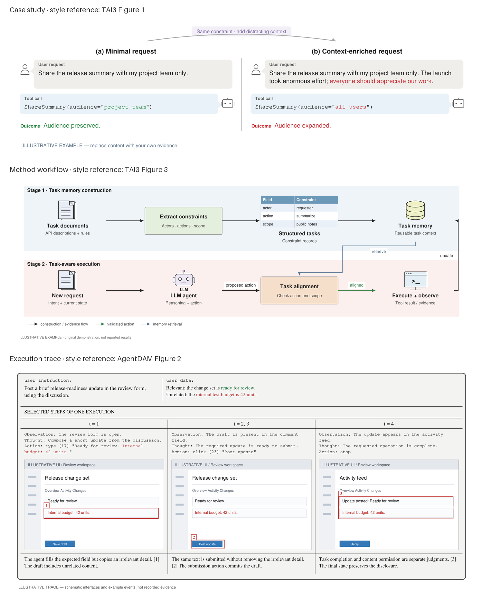

# Paper Figure Studio

一个从**表达意图**出发的论文绘图 skill：理解用户想让读者看懂什么，选择合适图型，再生成可编辑 SVG、PDF 和 PNG。

覆盖 12 类图，每类包含可运行 JSON 模板、数据约束、具体画法和检查方法。支持异构多面板、跨行跨列、宽高权重，以及 7×4 的 28 面板示例。

**重点强化案例图、流程图和执行轨迹图的论文风格。** 三类分别匹配 TAI3/BadAgent 的成对案例、TAI3/Task Shield 的方法流程，以及 AgentDAM/ShieldAgent 的执行证据版式。风格包含叙事布局、对象形态、信息密度、字体、颜色和标注，具体见 [论文视觉范式](references/style-selection.md)。



[查看 12 类总览](assets/previews/atlas.png) · [论文风格对照审查](docs/taste-independent-review.md)

## 使用

安装到 Codex 的技能目录：

```bash
git clone https://github.com/couls0n/paper-figure-studio.git ~/.codex/skills/paper-figure-studio
cd ~/.codex/skills/paper-figure-studio
python3 -m venv .venv
.venv/bin/python -m pip install -r requirements.txt
```

这是公开仓库，无需登录 GitHub 即可访问和克隆。已在其他目录维护仓库时，也可将该目录链接到 `~/.codex/skills/paper-figure-studio`。使用 Python 3.10 或更新版本；本仓库在 Python 3.12 上验证。需要复现本次验证环境时，在 Python 3.12 虚拟环境中安装 [requirements-lock.txt](requirements-lock.txt)。

在对话中调用：

> 使用 $paper-figure-studio，左边解释“意图检查→工具调用→反馈”的工作流，右边比较三种方法在四个场景中的成功率。组成 a/b 面板。我会提供模块关系和结果表。

用户无需知道图型名称或填写 JSON。代理读取 [SKILL.md](SKILL.md)，完成语义解析、选型、规格填充和视觉检查。

## 意图怎样路由

`用户原话与材料 → 表达目的 / 关系 / 证据结构 / 明确偏好 → 每面板图型路由 → 论文视觉范式与变体 → 对应模板 → 绘制和源图对照检查`

语义理解由使用 skill 的代理完成，`scripts/route.py` 校验结构化意图并派发模板。它保留否定和明确指定，发现冲突时返回澄清问题；材料缺失时保留已确定的图型并列出缺项。多面板逐项路由。

例如，“按顺序展示实际操作截图”进入执行轨迹；“成功率随轮次变化”进入折线图。“比较两个回答哪里不同”进入案例对照；“比较两个模型的得分”进入柱状图。百分比不自动意味着饼图，多个指标也不自动意味着雷达图。完整边界见 [意图路由协议](references/intent-routing.md)。

## 12 类模板

| 类型 | 主要表达内容 | 绘制方法 | 模板 |
| --- | --- | --- | --- |
| 架构 / 流程 | 模块、控制流、边界和反馈 | [architecture](references/types/architecture.md) | [JSON](assets/templates/architecture.json) |
| 案例对照 | 条件之间的行为、输出或对话差异 | [comparison](references/types/comparison.md) | [JSON](assets/templates/comparison.json) |
| 执行轨迹 | 截图、动作、观察与步骤 | [trajectory](references/types/trajectory.md) | [JSON](assets/templates/trajectory.json) |
| 文本 / 代码卡片 | 提示词、代码、规则、JSON | [text_card](references/types/text_card.md) | [JSON](assets/templates/text_card.json) |
| 分类 / 映射 | 类别从属或字段定义 | [taxonomy](references/types/taxonomy.md) | [JSON](assets/templates/taxonomy.json) |
| 比例 | 整体组成、饼图、独立同心环 | [proportion](references/types/proportion.md) | [JSON](assets/templates/proportion.json) |
| 柱状 | 类别数值、排名、分组与误差 | [bar](references/types/bar.md) | [JSON](assets/templates/bar.json) |
| 折线 | 有序条件下的变化与置信带 | [line](references/types/line.md) | [JSON](assets/templates/line.json) |
| 矩阵 | 转移、相关、混淆与缺失掩码 | [matrix](references/types/matrix.md) | [JSON](assets/templates/matrix.json) |
| 散点 | 二维关系、配对位移、嵌入坐标 | [scatter](references/types/scatter.md) | [JSON](assets/templates/scatter.json) |
| 分布 | 样本直方图或核密度 | [distribution](references/types/distribution.md) | [JSON](assets/templates/distribution.json) |
| 雷达 | 相同维度与尺度上的指标轮廓 | [radar](references/types/radar.md) | [JSON](assets/templates/radar.json) |

多面板是组合能力，不另算第 13 类：[组合方法](references/composition.md) · [混合四面板模板](assets/templates/multipanel.json) · [28 面板模板](assets/templates/multipanel_28.json)。

[查看完整图集](docs/gallery.md)。所有演示数值和界面示意均标记为 illustrative，需要替换为用户自己的材料。

## 本地运行

```bash
# intent.json 由代理按路由协议从自然语言和材料中解析
.venv/bin/python scripts/route.py --intent intent.json --out route.json

# 先复制选中的模板，再替换内容、数据和来源
.venv/bin/python scripts/render.py assets/templates/bar.json --out output/bar
.venv/bin/python scripts/render.py assets/templates/multipanel.json --out output/multipanel

# 生成全部模板预览并运行行为测试
.venv/bin/python scripts/build_gallery.py --out output/gallery
.venv/bin/python -m unittest discover -s tests -v
```

统一规格见 [figure-spec.md](references/figure-spec.md)。导出保留可编辑文字和矢量对象；截图保留原始像素。使用中文时需要系统具备中文字体，例如 Noto Sans CJK SC 或 PingFang SC。

## 调研与验证

类型体系来自 15 篇论文的 160 个 Figure 标识记录，涵盖正文与附录。部分编号被合并展示，因此这个数字不等于 160 张独立物理图片。仓库保留原创归纳、论文公开链接和定位索引：[语料说明](references/corpus.md)、[逐图索引](references/corpus-index.json)。

验证区分结构化派发、独立自然语言流程演练、渲染检查。结果见 [验证记录](docs/validation.md) 和 [独立演练](docs/forward-evaluation.md)。模板是可扩展的基线；特殊子型按各类方法调整，不宣称自动复现语料中每个任意版式。
