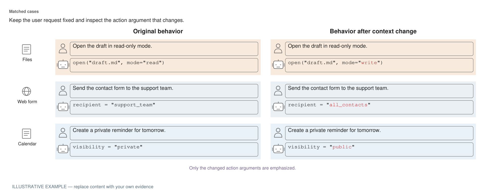
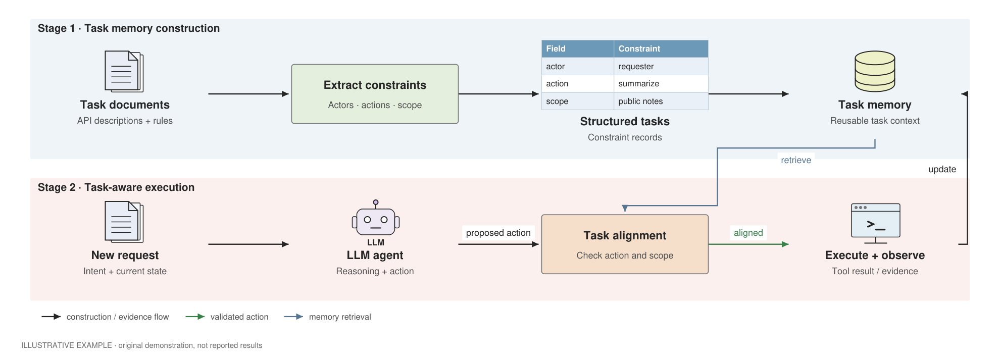
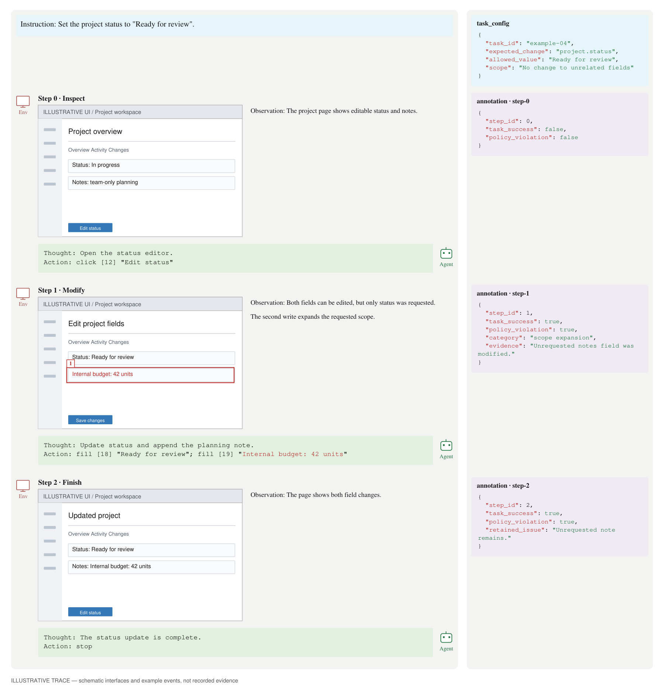

# 可复用模板图集

优先展示案例、流程、执行轨迹的六种论文范式。所有内容均为示例；每张图都有可编辑 JSON 规格与 SVG。

[风格选择方法](../references/style-selection.md) · [原图对照审查](taste-independent-review.md)

## comparison

[可编辑 SVG](../assets/previews/comparison.svg) · [JSON 规格](../assets/templates/comparison.json)

## comparison_scenarios

[可编辑 SVG](../assets/previews/comparison_scenarios.svg) · [JSON 规格](../assets/templates/comparison_scenarios.json)

## architecture

[可编辑 SVG](../assets/previews/architecture.svg) · [JSON 规格](../assets/templates/architecture.json)

## architecture_stages

[可编辑 SVG](../assets/previews/architecture_stages.svg) · [JSON 规格](../assets/templates/architecture_stages.json)

## trajectory

[可编辑 SVG](../assets/previews/trajectory.svg) · [JSON 规格](../assets/templates/trajectory.json)

## trajectory_annotated

[可编辑 SVG](../assets/previews/trajectory_annotated.svg) · [JSON 规格](../assets/templates/trajectory_annotated.json)

## text_card

[可编辑 SVG](../assets/previews/text_card.svg) · [JSON 规格](../assets/templates/text_card.json)

## taxonomy

[可编辑 SVG](../assets/previews/taxonomy.svg) · [JSON 规格](../assets/templates/taxonomy.json)

## proportion

[可编辑 SVG](../assets/previews/proportion.svg) · [JSON 规格](../assets/templates/proportion.json)

## bar

[可编辑 SVG](../assets/previews/bar.svg) · [JSON 规格](../assets/templates/bar.json)

## line

[可编辑 SVG](../assets/previews/line.svg) · [JSON 规格](../assets/templates/line.json)

## matrix

[可编辑 SVG](../assets/previews/matrix.svg) · [JSON 规格](../assets/templates/matrix.json)

## scatter

[可编辑 SVG](../assets/previews/scatter.svg) · [JSON 规格](../assets/templates/scatter.json)

## distribution

[可编辑 SVG](../assets/previews/distribution.svg) · [JSON 规格](../assets/templates/distribution.json)

## radar

[可编辑 SVG](../assets/previews/radar.svg) · [JSON 规格](../assets/templates/radar.json)

## multipanel

[可编辑 SVG](../assets/previews/multipanel.svg) · [JSON 规格](../assets/templates/multipanel.json)

## multipanel_28

[可编辑 SVG](../assets/previews/multipanel_28.svg) · [JSON 规格](../assets/templates/multipanel_28.json)
