# 可复用模板图集

所有内容均为示例；每张图都对应可编辑JSON规格与SVG。

## architecture

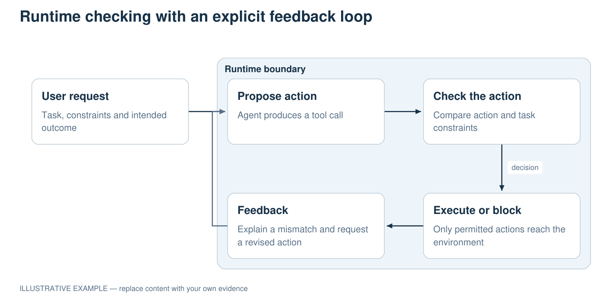

[可编辑 SVG](../assets/previews/architecture.svg) · [JSON 规格](../assets/templates/architecture.json)

## comparison

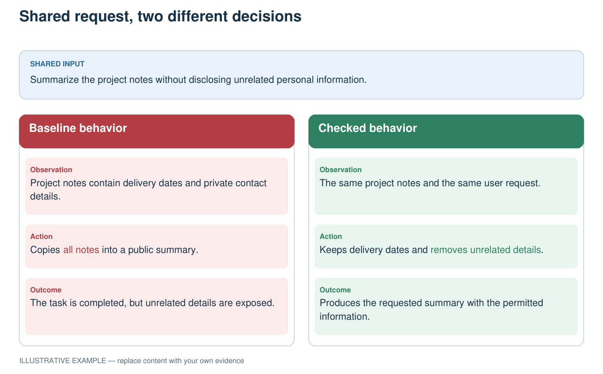

[可编辑 SVG](../assets/previews/comparison.svg) · [JSON 规格](../assets/templates/comparison.json)

## trajectory

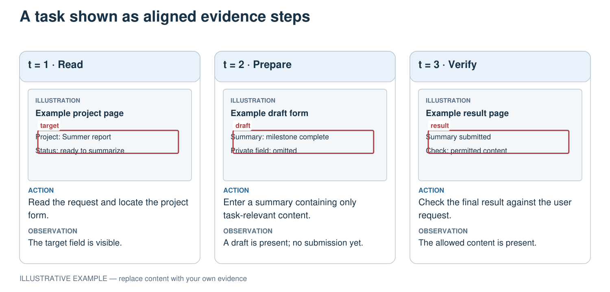

[可编辑 SVG](../assets/previews/trajectory.svg) · [JSON 规格](../assets/templates/trajectory.json)

## text_card

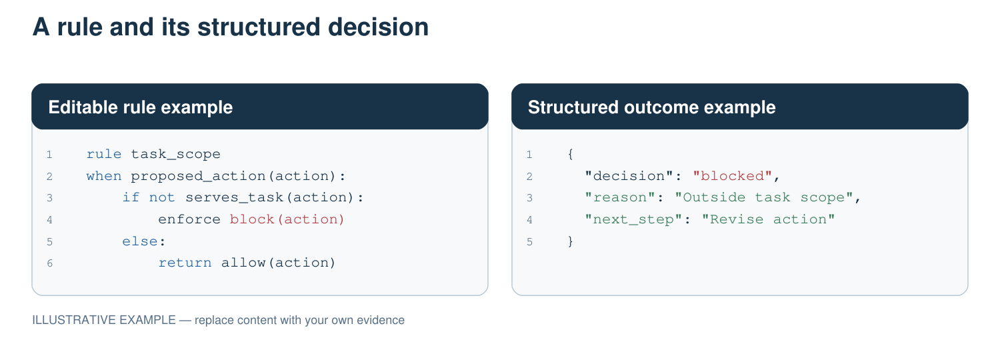

[可编辑 SVG](../assets/previews/text_card.svg) · [JSON 规格](../assets/templates/text_card.json)

## taxonomy

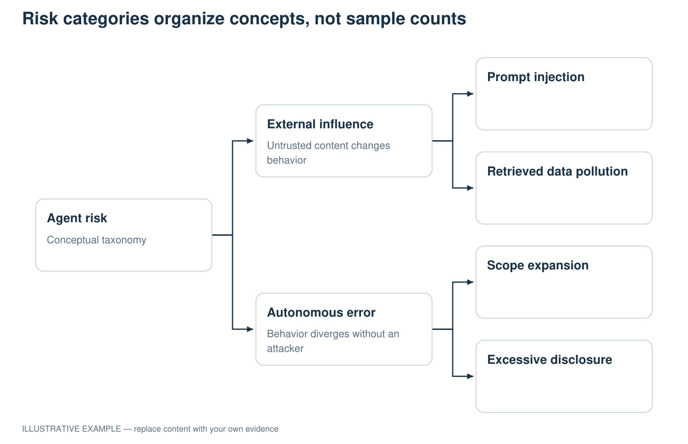

[可编辑 SVG](../assets/previews/taxonomy.svg) · [JSON 规格](../assets/templates/taxonomy.json)

## proportion

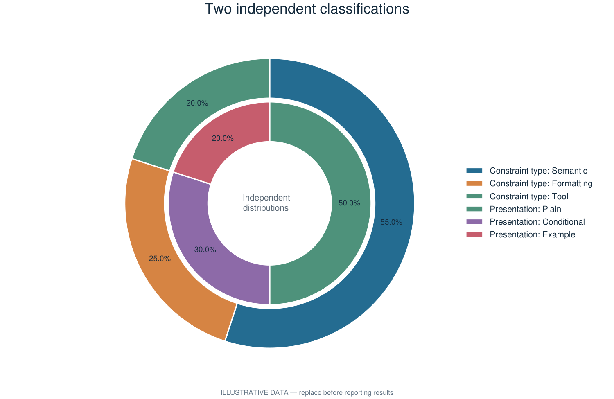

[可编辑 SVG](../assets/previews/proportion.svg) · [JSON 规格](../assets/templates/proportion.json)

## bar

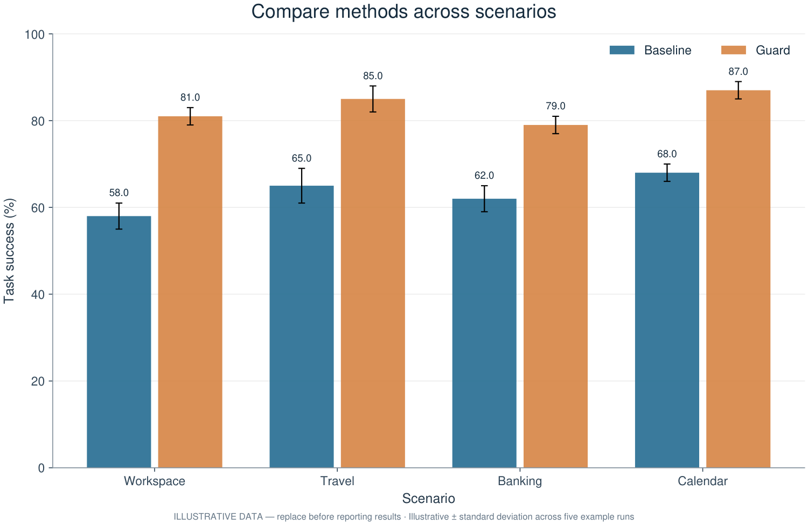

[可编辑 SVG](../assets/previews/bar.svg) · [JSON 规格](../assets/templates/bar.json)

## line

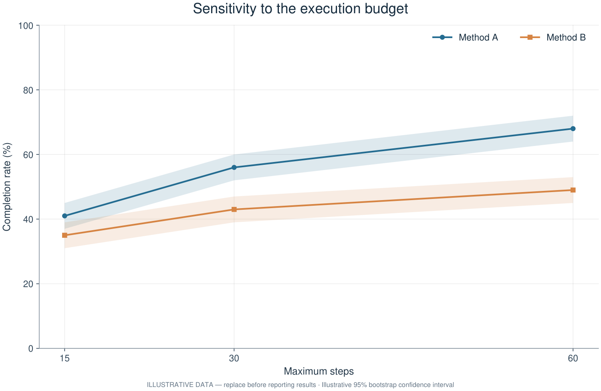

[可编辑 SVG](../assets/previews/line.svg) · [JSON 规格](../assets/templates/line.json)

## matrix

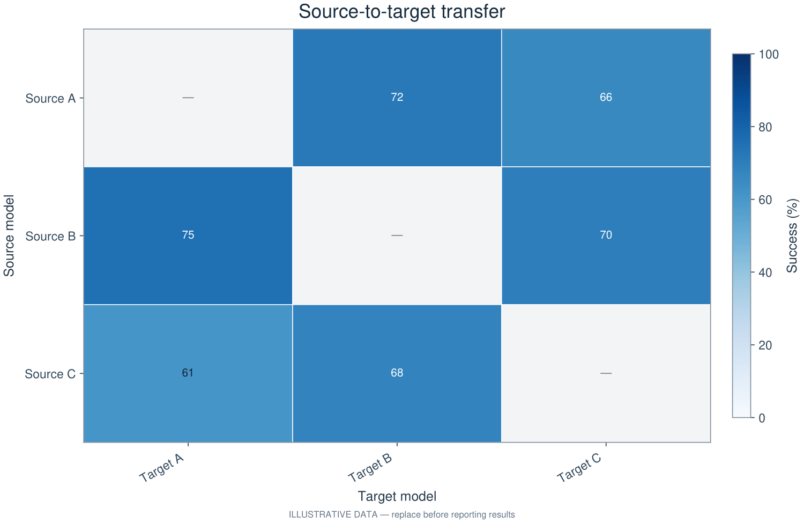

[可编辑 SVG](../assets/previews/matrix.svg) · [JSON 规格](../assets/templates/matrix.json)

## scatter

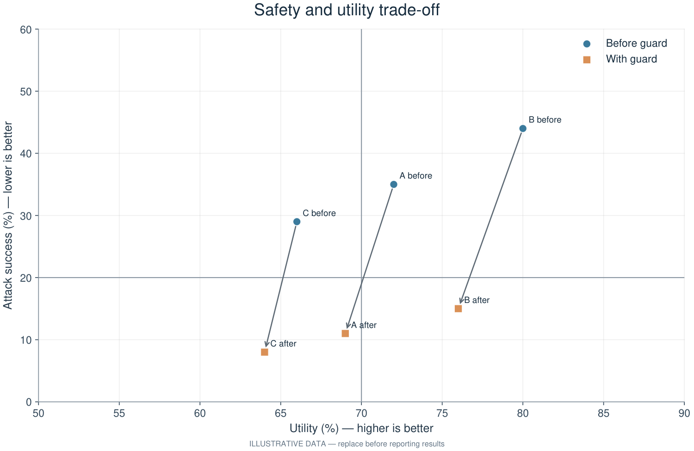

[可编辑 SVG](../assets/previews/scatter.svg) · [JSON 规格](../assets/templates/scatter.json)

## distribution

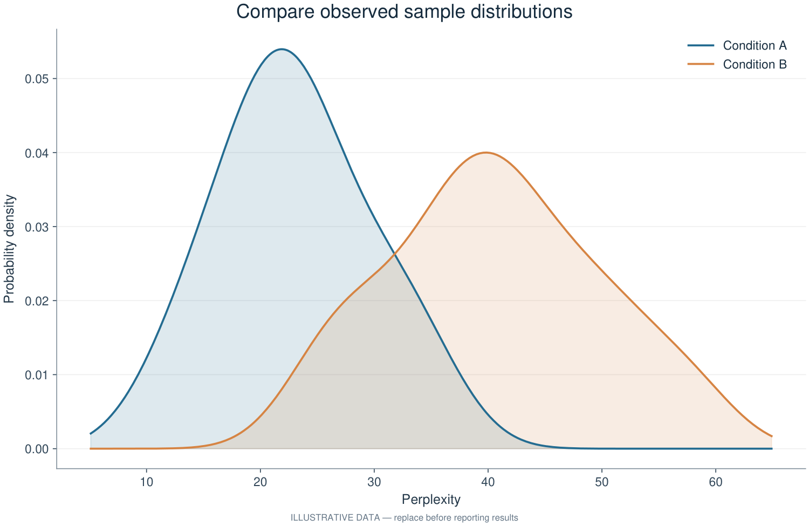

[可编辑 SVG](../assets/previews/distribution.svg) · [JSON 规格](../assets/templates/distribution.json)

## radar

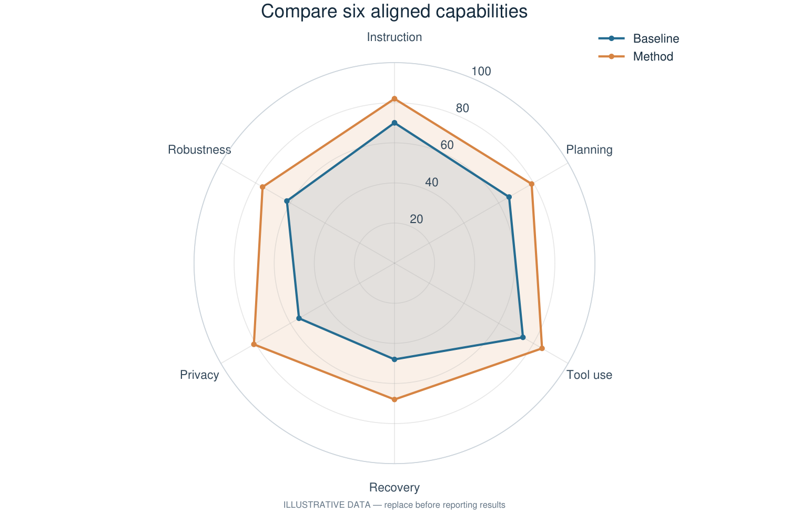

[可编辑 SVG](../assets/previews/radar.svg) · [JSON 规格](../assets/templates/radar.json)

## multipanel

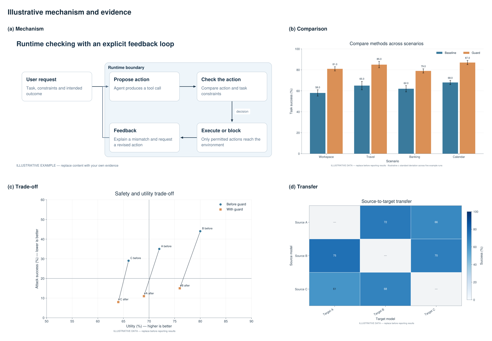

[可编辑 SVG](../assets/previews/multipanel.svg) · [JSON 规格](../assets/templates/multipanel.json)

## multipanel_28

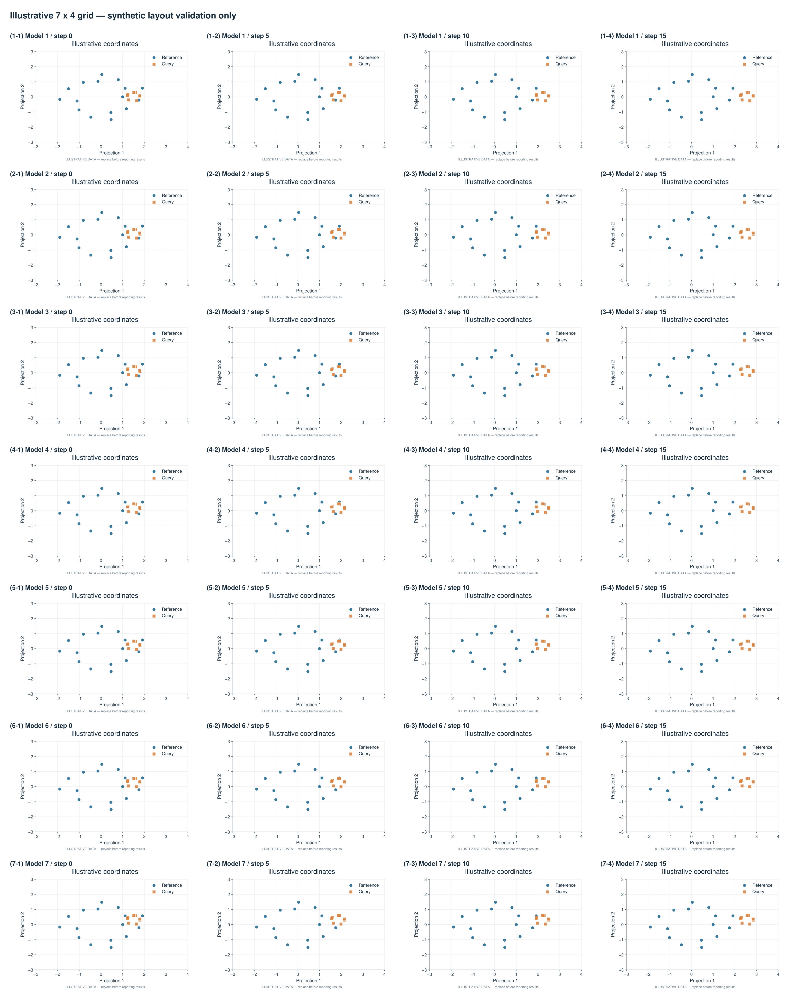

[可编辑 SVG](../assets/previews/multipanel_28.svg) · [JSON 规格](../assets/templates/multipanel_28.json)
